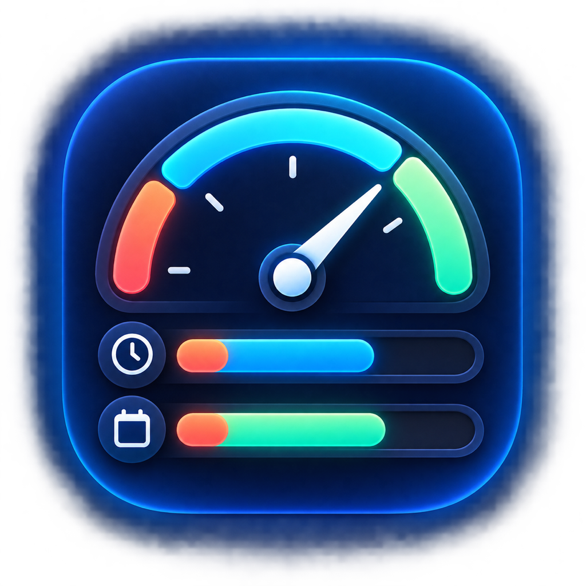
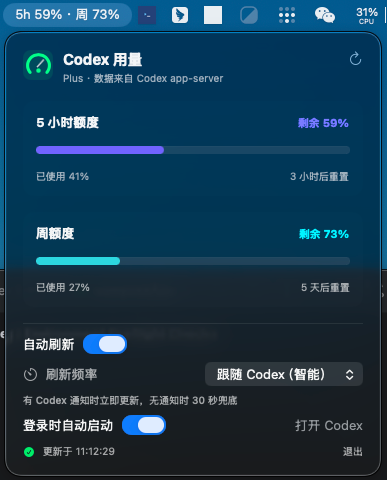

# CodexQuotaMenu

一个原生 macOS 菜单栏工具，用于读取并显示 Codex 的 5 小时额度和周额度。



## 截图

菜单栏会直接显示 5 小时和周额度的剩余百分比：


点击菜单栏图标后，可以查看详细额度、重置时间、缓存状态和刷新设置：



## 功能

- 显示 5 小时额度、周额度、已使用百分比、剩余百分比和预计重置时间。
- 直接连接本机 Codex `app-server`，不创建第二套登录流程。
- “跟随 Codex（智能）”：收到额度更新通知时立即刷新，没有通知时每 30 秒兜底读取。
- 支持 30 秒、1 分钟、3 分钟、5 分钟和 10 分钟刷新间隔。
- 最近一次成功结果本地缓存；读取失败时明确标记为缓存数据。
- 支持手动刷新和登录时自动启动。
- 提供 macOS 应用图标、状态栏 gauge mark 和统一的弹窗视觉素材。

## 数据与隐私

工具通过本机 Codex CLI 的 JSON-RPC app-server 读取额度：

```text
initialize → initialized → account/rateLimits/read
```

它不会要求 API Key，不会读取或保存认证 token，也不会实现另一套 ChatGPT 登录。应用运行期间复用一个 app-server 进程。

额度字段映射如下：

| Codex 字段 | 显示内容 |
| --- | --- |
| `primary`，`windowDurationMins = 300` | 5 小时额度 |
| `secondary`，`windowDurationMins = 10080` | 周额度 |
| `usedPercent` | 已使用百分比 |
| `resetsAt` | 重置时间 |

## 系统要求

- macOS 13 或更高版本
- Swift 5.9 或更高版本
- 已安装并登录 ChatGPT/Codex，且本机可用 Codex CLI app-server

## 构建

### 使用 Xcode

打开 `CodexQuotaMenu.xcodeproj`，选择 `CodexQuotaMenu` scheme 后运行或构建。

### 使用命令行

```bash
swift test
./scripts/build_app.sh
open CodexQuotaMenu.app
```

构建脚本使用标准 Xcode 工程生成 Release App，并签名为本机开发用途的 ad-hoc 签名。生成的 App 是 `LSUIElement` 状态栏应用，不会在 Dock 中显示普通窗口。

如果需要登录时自动启动，建议先将 App 复制到 `/Applications`，再在菜单中打开该开关：

```bash
ditto CodexQuotaMenu.app /Applications/CodexQuotaMenu.app
```

## Codex CLI 路径兼容

工具会依次兼容以下来源：

- `CODEX_CLI_PATH` 手动指定路径。
- ChatGPT 新版稳定包装入口：
  `Contents/Resources/codex-cli/bin/codex`。
- ChatGPT 新版嵌套 CLI App：
  `Contents/Resources/codex-cli/CodexCLI.app/Contents/MacOS/codex`。
- 旧版：`Contents/Resources/codex`。
- `/Applications/Codex.app` 和用户目录下的 ChatGPT/Codex App。
- Homebrew、MacPorts、常见用户级 Node 安装目录和 `PATH`。

优先使用新版 `codex-cli/bin/codex` 包装入口，以减少对 ChatGPT 内部目录结构的依赖。

## 工程结构

```text
CodexQuotaMenu/
├── CodexQuotaMenu.xcodeproj/       # 标准 Xcode 工程
├── Package.swift                   # Swift Package 入口
├── Assets/                         # 图标和资源
├── Sources/CodexQuotaCore/         # app-server 客户端和额度模型
├── Sources/CodexQuotaMenu/         # SwiftUI 菜单栏界面和状态管理
├── Tests/CodexQuotaCoreTests/      # 单元测试
└── scripts/build_app.sh            # Release 构建脚本
```

`project.yml` 是可选的工程描述文件；仓库已提交生成后的 `.xcodeproj`，不需要安装 XcodeGen 才能打开工程。

## 测试

```bash
swift test
```

测试覆盖额度 JSON 解码、5 小时/周窗口映射、百分比边界保护和稀疏额度更新合并。

## 限制

“跟随 Codex（智能）”是 app-server 通知优先、30 秒兜底，并不是读取 ChatGPT/Codex 主窗口的私有内存状态。Codex CLI 的路径和 app-server 协议属于外部版本依赖，未来版本变化时可能需要更新兼容逻辑。

## 文档

- [当前会话整理](CURRENT_SESSION_SUMMARY.md)
- [变更记录](CHANGELOG.md)
- [贡献说明](CONTRIBUTING.md)

## 许可证

[MIT License](LICENSE)
